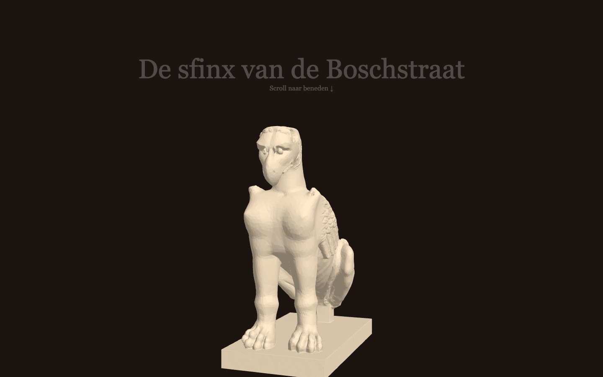

# De sfinx van de Boschstraat · GSAP + Three.js

Een simpele scrolly story voor beginners: een 3D-model uit Blender dat meedraait terwijl je scrollt. Gemaakt voor het vak **Multi Media Technology 5** (CMD, Zuyd Hogeschool).

**▶ [Bekijk de live demo](https://willmuijrers.github.io/sfinx-gsap-three.js-test/)**



## Wat zie je?

Drie schermen. Terwijl je naar beneden scrollt:

| Scherm | Wat er gebeurt |
| ------ | -------------- |
| 1 | De titel komt binnen. De sfinx staat in het midden. |
| 2 · 1834 | De sfinx draait een halve slag en schuift naar **rechts**. Links verschijnt de tekst. |
| 3 · 2006 | De sfinx draait verder (een hele slag) en schuift naar **links**. Rechts verschijnt de tekst. |

## Downloaden en openen

1. Klik hierboven op de groene knop **Code** → **Download ZIP**, en pak de zip uit.
2. Open de map in **VS Code**.
3. Klik met rechts op `index.html` → **Open with Live Server**.

> ⚠️ **Een dubbelklik op `index.html` werkt niet.** De browser blokkeert dan het inladen van `sphinx.glb`. Gebruik altijd een lokale server, zoals de VS Code-extensie _Live Server_.

## De bestanden

```
├── index.html     de drie schermen + de <script>-tags
├── style.css      de opmaak
├── script.js      de 3D-wereld en de animaties
└── sphinx.glb     het 3D-model uit Blender
```

## Hoe werkt `script.js`?

Het script bestaat uit vijf blokken:

1. **De 3D-wereld**: een `scene` (de wereld), een `camera` (waar je vandaan kijkt), een `renderer` (die tekent op het `<canvas>`) en twee lampen.
2. **De tekst animeren**: de titel komt binnen met `gsap.from()`, en per scherm schuift de tekst omhoog met een `scrollTrigger`.
3. **De sfinx inladen en animeren**: `loader.load('sphinx.glb', ...)` laadt het model. **Alle sfinx-animaties staan ín die functie**, want pas als het model geladen is, bestaat de sfinx. Per scherm zijn er twee animaties: één voor de **draai** (`sphinx.rotation`) en één voor de **positie** (`sphinx.position`).
4. **Elk frame opnieuw tekenen** met `gsap.ticker`.
5. **Venster van grootte veranderd?** Dan passen canvas en camera zich aan.

De belangrijkste regel om te snappen:

```js
gsap.to(sphinx.rotation, {
    y: Math.PI,               // Math.PI = een halve draai (180 graden)
    scrollTrigger: {
        trigger: '.second',   // let op scherm 2...
        start: 'top bottom',  // begin: scherm 2 komt onderin beeld
        end: 'top top',       // einde: scherm 2 staat helemaal in beeld
        scrub: true           // de animatie loopt mee met je scroll
    }
});
```

GSAP animeert hier geen CSS, maar gewoon een getal in JavaScript: de draai van het 3D-model. GSAP kan **elk getal** animeren.

## Probeer dit

1. Verander de `duration` van de titel-animatie van `1.5` naar `3`. Wat gebeurt er?
2. Verander bij scherm 2 `x: 2.5` in `x: 4`. Waar staat de sfinx nu?
3. Verander `Math.PI` in `Math.PI / 2`. Hoe staat de sfinx er nu bij in scherm 2?
4. Zet `scrub: true` op `scrub: 2`. Wat voel je bij het scrollen?
5. Laat de sfinx in scherm 3 kleiner worden: `gsap.to(sphinx.scale, { x: 0.7, y: 0.7, z: 0.7, scrollTrigger: { ... } })`.
6. **Uitdaging:** voeg een vierde scherm toe, met een eigen tekst en een eigen beweging van de sfinx.

## Over het 3D-model

`sphinx.glb` is in Blender voorbereid, zodat de code zo simpel mogelijk kan blijven:

- **in het midden** gezet en **4 eenheden hoog** gemaakt;
- **gedraaid** zodat hij naar de camera kijkt;
- de vlakken **naar buiten gedraaid** (het gescande model stond binnenstebuiten);
- een **zandsteen-materiaal** gegeven.

Alles wat je in Blender goed voorbereidt, hoef je niet te programmeren. 🙌

## Gebruikt

- [Three.js](https://threejs.org/) r147, via een gewone `<script>`-tag
- [GSAP](https://gsap.com/) 3.15 met [ScrollTrigger](https://gsap.com/docs/v3/Plugins/ScrollTrigger/)

> **Waarom Three.js r147?** Dat is de laatste versie die je met een gewone `<script>`-tag kunt koppelen. Nieuwere versies werken alleen nog als ES module (`import`). Dat leer je later in het vak, in een project met Vite en npm.

## Bronnen

- Verhaal: Wikipedia, [Koninklijke Sphinx](https://nl.wikipedia.org/wiki/Koninklijke_Sphinx) en [Sphinxkwartier](https://nl.wikipedia.org/wiki/Sphinxkwartier)
- 3D-model: _Seated Sphinx with Griffin Head_
